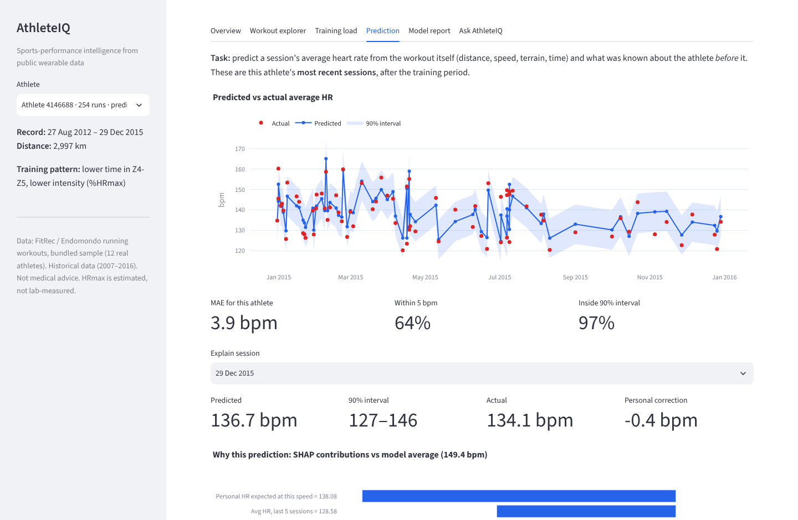
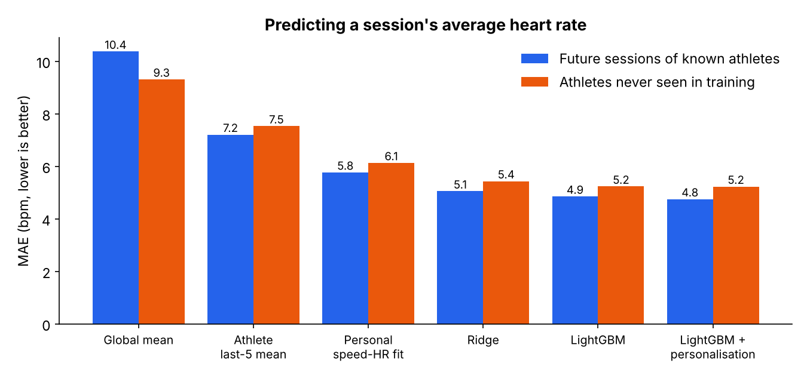
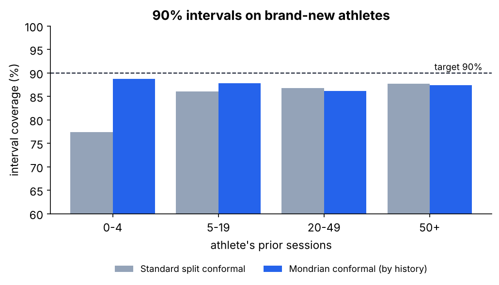
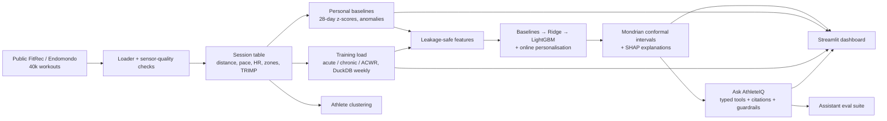
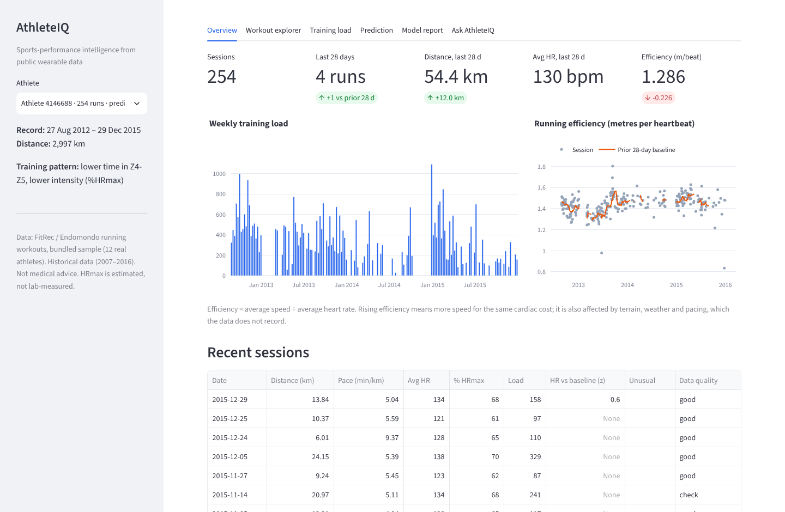
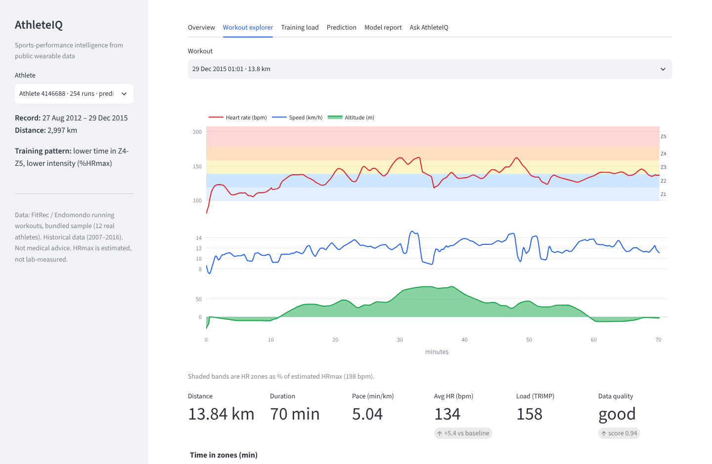
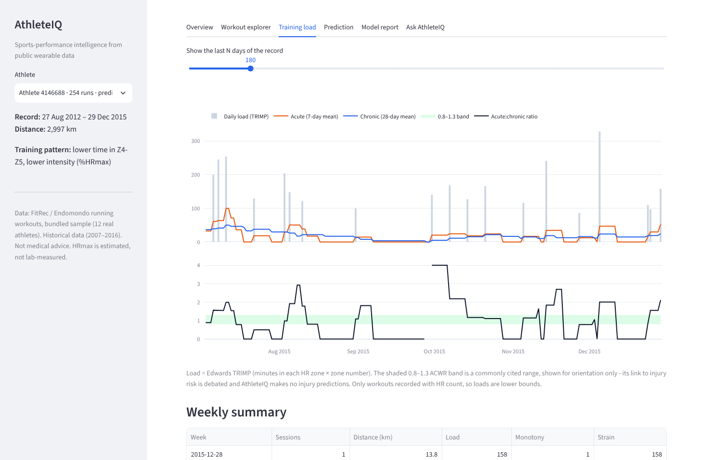
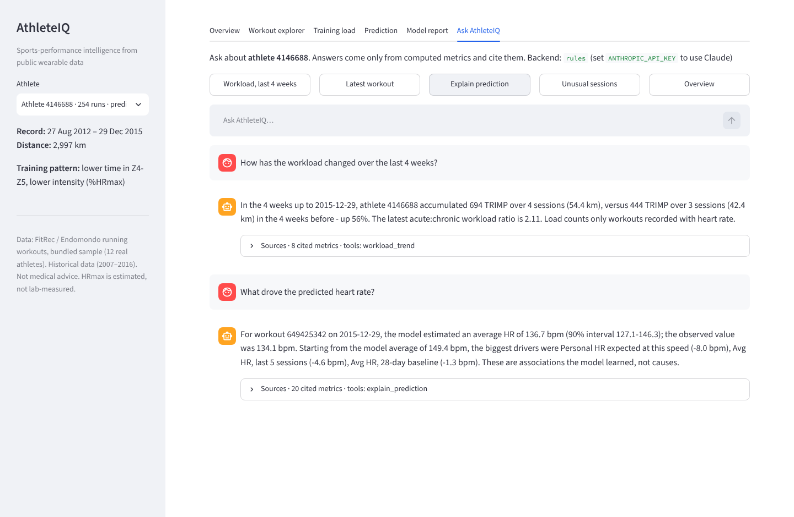
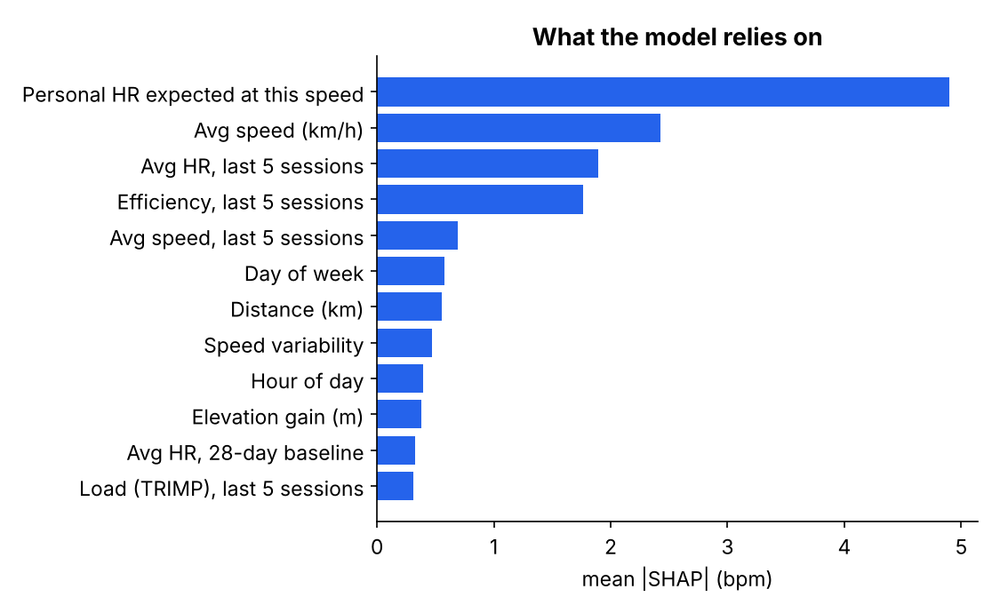
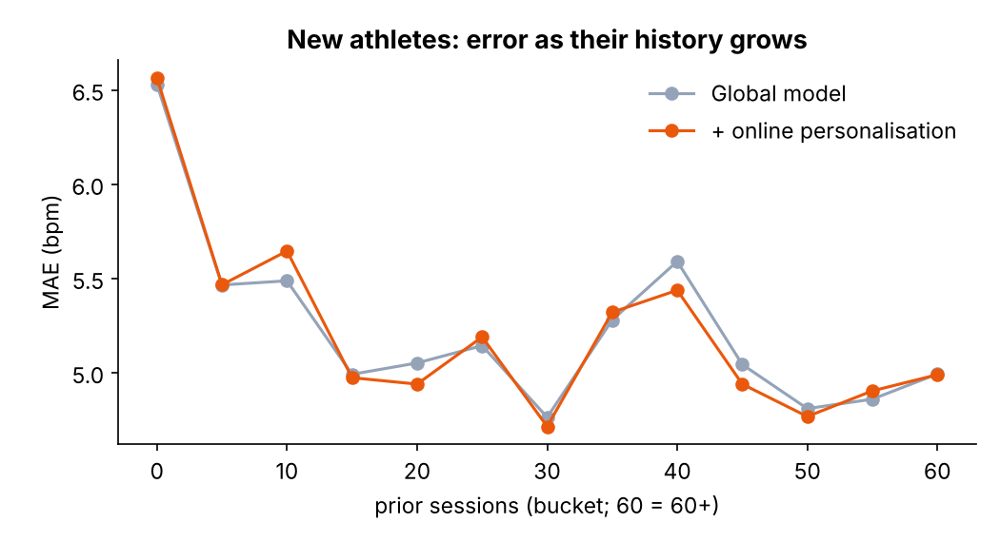

# AthleteIQ

**Sports-performance intelligence from real wearable data: personal baselines, training load, a heart-rate
model that knows how uncertain it is, and an AI analyst that can only say what the numbers support.**

[](https://github.com/JAGDISHRATHORE/AthleteIQ/actions/workflows/ci.yml)




Built on **40,186 real running workouts from 761 athletes** (the public FitRec / Endomondo dataset):
second-by-second heart rate, speed and altitude. No invented data, no proprietary-algorithm claims, and
every number on screen traces back to a documented calculation.

## Results at a glance

All numbers are measured on data the model never trained on (`models/metrics.json`).

| | Future sessions of known athletes | Athletes never seen in training |
|---|---|---|
| Heart-rate prediction error (MAE) | **4.75 bpm** (R² 0.76) | **5.23 bpm** (R² 0.65) |
| vs. "athlete's recent average" baseline | **34 % lower** error (7.21 bpm) | **31 % lower** error (7.53 bpm) |
| 90 % prediction-interval coverage | **89.2 %** | **87.3 %** |
| New athletes' first 5 sessions: interval coverage | — | **88.7 %** with Mondrian conformal vs 77.4 % standard |
| AI analyst evals (244 questions, offline backend) | 100 % routing · 0 unsupported numbers · 100 % refusal of medical questions | |

<p>


</p>

## What makes it different

1. **Leakage-safe by construction, and tested.** Every athlete is evaluated on their *future*; a separate
   15 % of athletes is never seen in training. Baselines and features only look backwards — unit tests
   change a session's own heart rate and check its features do not move.
2. **Personal, not just global.** The strongest signal is each athlete's *own* speed→heart-rate line from
   earlier runs. An online, shrinkage-based correction then learns each athlete's residual bias as new
   sessions arrive.
3. **Honest uncertainty.** Conformal prediction gives every forecast a 90 % range and the coverage is
   measured. Standard conformal under-covered new athletes (77 %); group-wise **Mondrian conformal** fixes
   it (89 %) by giving athletes with little history wider, honest intervals.
4. **An AI analyst that is graded like a model.** Ask AthleteIQ answers only through typed tools over
   computed metrics; every number it says carries a citation (observed / model estimate / definition),
   and medical questions are declined before any tool runs. An eval suite with independently computed
   answers measures routing, numeric accuracy, hallucinated numbers and refusals.
5. **Sensor-quality aware.** Every session gets HR-dropout / spike / GPS-jump / recording-gap checks and a
   quality label that the dashboard and assistant surface.
6. **Engineered like a product.** Config-driven pipeline, DuckDB SQL for weekly aggregates, 32 tests, CI on
   Python 3.10 and 3.12, Docker, data card, model card and methodology with references.

## Architecture



## Quick start

```bash
git clone https://github.com/JAGDISHRATHORE/AthleteIQ.git
cd AthleteIQ
python -m venv .venv && source .venv/bin/activate      # Windows: .venv\Scripts\activate
pip install -r requirements-dev.txt

streamlit run dashboard/app.py      # runs immediately on the bundled 12-athlete real-data sample
pytest -q                           # 32 tests
```

Reproduce everything on the full dataset (~330 MB download, then a few minutes to build and train on a laptop):

```bash
make all            # download → build → train → sample → figures → evals → notebooks → test
# or step by step:
python scripts/run_pipeline.py download
python scripts/run_pipeline.py build
python scripts/run_pipeline.py train
python -m assistant.evals.run_evals --athletes 40
```

Use Claude as the assistant backend (optional):

```bash
export ANTHROPIC_API_KEY=...        # the dashboard switches to the LLM backend automatically
python -m assistant.evals.run_evals --backend llm --athletes 12
```

Docker: `docker build -t athleteiq . && docker run -p 8501:8501 athleteiq`

## The dashboard

| Overview | Workout explorer |
|---|---|
|  |  |
| **Training load** | **Ask AthleteIQ** |
|  |  |

* **Overview** — volume, heart rate and running efficiency (metres per heartbeat) against a personal baseline.
* **Workout explorer** — HR, speed and altitude for one run, with HR zones and data-quality flags.
* **Training load** — daily TRIMP, acute / chronic load, ACWR, weekly monotony and strain.
* **Prediction** — predicted vs actual HR with 90 % intervals and a SHAP explanation for any session.
* **Model report** — all models on both test sets, coverage, cold-start curve, error analysis.
* **Ask AthleteIQ** — natural-language questions with cited, tool-grounded answers.

## Methodology in brief

Full details: [`docs/methodology.md`](docs/methodology.md) · [`docs/data_card.md`](docs/data_card.md) ·
[`docs/model_card.md`](docs/model_card.md) · notebooks [`01`](notebooks/01_data_exploration.ipynb),
[`02`](notebooks/02_model_experiments.ipynb).

* **Intensity** — Edwards heart-rate zones on an HRmax estimated *online* from each athlete's own data
  (no lab test exists), Edwards TRIMP as session load.
* **Baselines** — each session vs the athlete's previous 28 days (z-scores with a minimum spread);
  |z| > 2 is flagged as unusual.
* **Prediction task** — a session's average HR from its external load (distance, speed profile, terrain,
  time) plus the athlete's history *before* it. 22 features; the dataset's HR-derived workout label is
  excluded to avoid leakage.
* **Models** — global mean → athlete mean → personal speed–HR line → ridge → LightGBM → LightGBM with
  online personalisation (`offset = Σ past residuals / (n + k)`, k chosen on validation).
* **Uncertainty** — split conformal and Mondrian (by history length) conformal intervals.
* **Explainability** — TreeSHAP global importance and per-session explanations.

<p>


</p>

## Limitations (read before trusting a number)

* Running only, heart rate + GPS only: no sleep, HRV, age or lab HRmax, so **no readiness or medical score
  is attempted**.
* The dataset packager smoothed the series and removed workouts with mean HR < 120 bpm: very easy runs are
  missing, and the model is only valid in that range.
* Workouts not recorded with HR are invisible, so training loads are lower bounds and ACWR is noisy.
* High-intensity / interval sessions are the weak spot (≈ 8 bpm error, ≈ 68 % interval coverage).
* Personalisation helps known athletes slightly (4.85 → 4.75 bpm) but not brand-new ones.
* Athlete clustering finds only weak structure (silhouette 0.22) — shown as a description, not a finding.
* SHAP explains the model, not physiology. Nothing here is medical advice.

## Repository layout

```
AthleteIQ/
├── config.yaml                 every threshold and parameter, in one place
├── src/athleteiq/              the library
│   ├── data_loader.py          download + load the public dataset
│   ├── quality.py              sensor-quality checks
│   ├── preprocessing.py        raw series → session table
│   ├── intensity.py            HR zones, online HRmax, Edwards TRIMP
│   ├── baselines.py            personal 28-day baselines, anomalies
│   ├── training_load.py        daily/acute/chronic load, ACWR, DuckDB weekly summary
│   ├── features.py             leakage-safe feature table
│   ├── model.py                splits, baselines, ridge, LightGBM, personalisation, conformal
│   ├── explainability.py       SHAP
│   ├── clustering.py           athlete training patterns
│   ├── pipeline.py             build + train orchestration
│   └── store.py                read API for the app and assistant
├── assistant/                  Ask AthleteIQ: tools, guardrails, backends, evals
├── dashboard/app.py            Streamlit app
├── scripts/                    pipeline, sample, figures, notebooks
├── notebooks/                  EDA and model experiments (executed)
├── models/                     trained model + metrics.json
├── data/sample/                12 real athletes, so everything runs after cloning
├── docs/                       data card, model card, methodology
└── tests/                      32 tests
```

## Data and credits

FitRec / Endomondo data: Ni, Muhlstein & McAuley, *Modeling Heart Rate and Activity Data for Personalized
Fitness Recommendation*, WWW 2019, via the Hugging Face re-packaging `rricc22/endomondo-hr-prediction-v2`.
Raw data is downloaded, not redistributed; see the data card for licence notes. Code: MIT.
